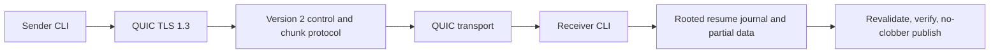

# Architecture

**Status: M2 implementation in progress.** One Go CLI hosts a sender or receiver. The sender opens a UDP QUIC listener and gives the intended receiver a fresh expiring one-use invite. The receiver validates the invite's ephemeral certificate, authenticates using its random capability, confirms metadata, and receives only chunks absent from its receiver-owned journal.

Packages are limited to CLI orchestration, invite authentication, protocol framing, transfer engine, QUIC adapter, and rooted filesystem operations. QUIC objects do not escape the adapter boundary.

The control plane is the authenticated QUIC connection, not a separate server. No rendezvous or relay exists. M2 still requires no public Internet or control service. One bidirectional control stream carries negotiation and the receiver's bounded committed-chunk bitmap; one unidirectional stream carries missing chunks in ascending order. Each data chunk is synced before its fixed-size checksummed journal record is synced. Recovery re-hashes every committed chunk and the full file before rooted no-clobber publication. Version 1 is not negotiated or silently accepted.

M2 adds a durable manifest/resume layer. M4/M5 research rendezvous, ICE/TURN, and encrypted relay separately. Smart path selection waits until at least direct and relay paths exist and supply measurements.
